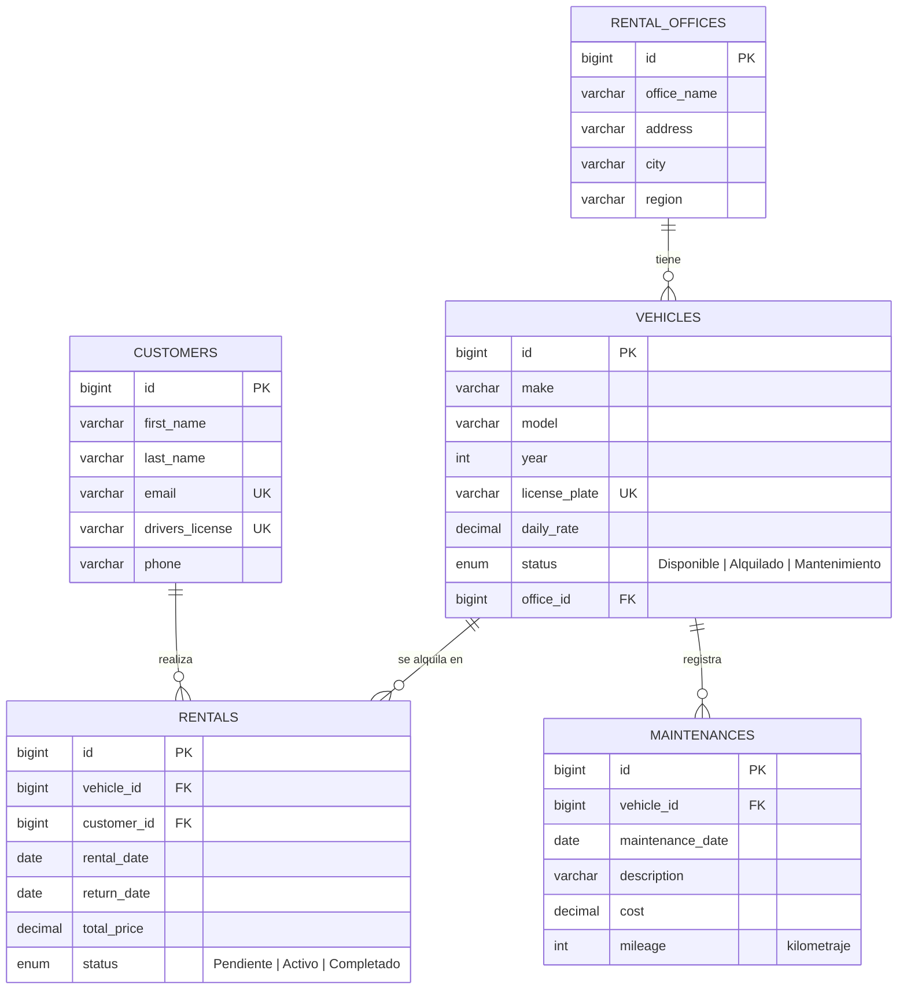

# API AlquilaYa: alquiler de vehículos

API REST de **AlquilaYa S.A.**, una empresa de alquiler de vehículos que quiere que apps móviles y agencias de viajes consulten su inventario y hagan reservas en tiempo real. Gestiona **oficinas**, **vehículos**, **clientes**, **alquileres** (con su ciclo Pendiente → Activo → Completado y el precio calculado automáticamente) y el historial de **mantenimientos**.

El repositorio incluye también la actividad de nivelación de POO del reto (carpeta `poo/`).

## Tecnologías

- Java 25 (compila con JDK 25 o superior)
- Spring Boot 4.1.1: Spring Web MVC y Spring Data JPA
- MySQL 8 o superior (driver `mysql-connector-j`)
- Maven (incluido con `mvnw`)
- Postman para las pruebas

## Estructura

```
api/                       API REST (Spring Boot)
└── src/main/java/com/api/alquilaya/
    ├── models/            Entidades JPA + enums VehicleStatus y RentalStatus
    ├── repositories/      Interfaces que extienden JpaRepository
    ├── services/          Lógica de negocio (no acceden a la base directamente)
    ├── controllers/       Controladores REST (@RestController)
    └── exceptions/        Manejo global de errores (400 / 404 en JSON)
database/alquilaya.sql     Script de la base de datos con datos de prueba
database/ver_datos.sql     Consultas para ver los datos en MySQL Workbench
postman/                   Colección de Postman (51 peticiones)
poo/                       Actividad de nivelación de POO (Java puro)
```

## Instalación y ejecución

1. Clona el repositorio:
   ```bash
   git clone https://github.com/enfrijoladas-martinez/api-alquilaya.git
   cd api-alquilaya
   ```
2. Crea la base de datos: abre `database/alquilaya.sql` en MySQL Workbench y ejecútalo. Crea la base `alquilaya` con 3 oficinas, 5 vehículos, 3 clientes, 2 alquileres y 3 mantenimientos. Se puede volver a ejecutar para reiniciar los datos.
3. Configura las variables de entorno: copia `api/.env.example` como `api/.env` y pon tu contraseña de MySQL.
   ```bash
   cp api/.env.example api/.env
   ```
4. Ejecuta la API:
   ```bash
   cd api
   ./mvnw spring-boot:run
   ```
   En Windows: `mvnw.cmd spring-boot:run`. También puedes abrir la carpeta en VS Code y ejecutar `AlquilayaApplication.java`.
5. La API queda en `http://localhost:8080`. Prueba con `GET http://localhost:8080/vehicles`.

## Variables de entorno

Se leen del sistema o del archivo `api/.env`. El archivo `.env` no se sube al repositorio.

| Variable | Descripción | Valor por defecto |
|---|---|---|
| `DB_HOST` | Servidor de MySQL | `localhost` |
| `DB_PORT` | Puerto de MySQL | `3306` |
| `DB_NAME` | Nombre de la base de datos | `alquilaya` |
| `DB_USERNAME` | Usuario de MySQL | `root` |
| `DB_PASSWORD` | Contraseña de MySQL | *(obligatoria)* |
| `SERVER_PORT` | Puerto de la API | `8080` |

## Modelo de datos



## Endpoints

### Oficinas `/offices`

| Método | Ruta | Descripción |
|---|---|---|
| GET | `/offices` | Lista las oficinas |
| GET | `/offices/{id}` | Obtiene una oficina |
| POST | `/offices` | Crea una oficina |
| PUT | `/offices/{id}` | Actualiza una oficina |
| DELETE | `/offices/{id}` | Elimina una oficina (si no tiene vehículos) |
| GET | `/offices/city/{city}` | Oficinas de una ciudad |
| GET | `/offices/region/{region}` | Oficinas de una región |

### Vehículos `/vehicles`

| Método | Ruta | Descripción |
|---|---|---|
| GET | `/vehicles` | Lista los vehículos |
| GET | `/vehicles/{id}` | Obtiene un vehículo |
| GET | `/vehicles/{id}/detalle` | Resumen en texto (`obtenerDetalle()`) |
| POST | `/vehicles` | Crea un vehículo (estado inicial `Disponible`) |
| PUT | `/vehicles/{id}` | Actualiza un vehículo |
| PUT | `/vehicles/{id}/status/{status}` | Cambia a `Disponible` o `Mantenimiento` |
| DELETE | `/vehicles/{id}` | Elimina un vehículo (si no tiene historial) |
| GET | `/vehicles/status/{status}` | Vehículos por estado |
| GET | `/vehicles/office/{officeId}` | Vehículos de una oficina |

### Clientes `/customers`

| Método | Ruta | Descripción |
|---|---|---|
| GET | `/customers` | Lista los clientes |
| GET | `/customers/{id}` | Obtiene un cliente |
| GET | `/customers/{id}/detalle` | Resumen en texto (`obtenerDetalle()`) |
| GET | `/customers/email/{email}` | Busca por email |
| POST | `/customers` | Crea un cliente |
| PUT | `/customers/{id}` | Actualiza un cliente |
| DELETE | `/customers/{id}` | Elimina un cliente (si no tiene alquileres) |

### Alquileres `/rentals`

| Método | Ruta | Descripción |
|---|---|---|
| GET | `/rentals` | Lista los alquileres |
| GET | `/rentals/{id}` | Obtiene un alquiler |
| GET | `/rentals/{id}/detalle` | Resumen en texto (`obtenerDetalle()`) |
| POST | `/rentals` | Crea la reserva en estado `Pendiente` y calcula `totalPrice` |
| PUT | `/rentals/{id}` | Modifica un alquiler `Pendiente` (recalcula el precio) |
| PUT | `/rentals/{id}/start` | `Pendiente` → `Activo`; el vehículo pasa a `Alquilado` |
| PUT | `/rentals/{id}/complete` | `Activo` → `Completado`; el vehículo vuelve a `Disponible` |
| DELETE | `/rentals/{id}` | Elimina un alquiler (si no está activo) |
| GET | `/rentals/customer/{id}` | Alquileres de un cliente |
| GET | `/rentals/vehicle/{id}` | Alquileres de un vehículo |
| GET | `/rentals/status/{status}` | Alquileres por estado |

### Mantenimientos `/maintenances`

| Método | Ruta | Descripción |
|---|---|---|
| GET | `/maintenances` | Lista los mantenimientos |
| GET | `/maintenances/{id}` | Obtiene un mantenimiento |
| POST | `/maintenances` | Registra un mantenimiento |
| PUT | `/maintenances/{id}` | Actualiza un mantenimiento |
| DELETE | `/maintenances/{id}` | Elimina un mantenimiento |
| GET | `/maintenances/vehicle/{vehicleId}` | Historial de un vehículo (más reciente primero) |

## Reglas y validaciones

- `totalPrice` = `dailyRate × días` (mínimo 1 día), calculado por `RentalModel.calcularPrecioTotal()`.
- No se alquila un vehículo en `Mantenimiento` ni uno que ya tenga otro alquiler `Pendiente` o `Activo` en esas fechas.
- `returnDate` no puede ser anterior a `rentalDate`.
- Placa, email y licencia de conducir son únicos.
- El estado `Alquilado` solo cambia iniciando o completando un alquiler.
- No se puede borrar una oficina con vehículos, ni un vehículo o cliente con historial.

| Código | Cuándo |
|---|---|
| 200 OK | Consulta, actualización o acción correcta |
| 201 Created | Recurso creado |
| 400 Bad Request | Dato inválido o regla de negocio incumplida |
| 404 Not Found | El recurso no existe |

## Ejemplos

Las relaciones se envían por id: `"vehicle": { "id": 1 }`.

### Crear un vehículo

`POST /vehicles`

```json
{
  "make": "Toyota",
  "model": "Corolla",
  "year": 2024,
  "licensePlate": "ABC123",
  "dailyRate": 50,
  "office": { "id": 1 }
}
```

Respuesta `201 Created`:

```json
{
  "id": 6,
  "make": "Toyota",
  "model": "Corolla",
  "year": 2024,
  "licensePlate": "ABC123",
  "dailyRate": 50,
  "status": "Disponible",
  "office": { "id": 1, "officeName": "AlquilaYa Centro", "address": "Calle 10 # 5-20", "city": "Bogotá", "region": "Cundinamarca" }
}
```

### Crear un alquiler

`POST /rentals`

```json
{
  "vehicle":  { "id": 1 },
  "customer": { "id": 2 },
  "rentalDate": "2026-12-01",
  "returnDate": "2026-12-08"
}
```

Respuesta `201 Created` (resumida): 7 días × 40.00 = 280.00.

```json
{
  "id": 3,
  "rentalDate": "2026-12-01",
  "returnDate": "2026-12-08",
  "totalPrice": 280.00,
  "status": "Pendiente",
  "vehicle":  { "id": 1, "make": "Seat", "model": "León", "licensePlate": "1234ABC", "dailyRate": 40.00, "status": "Disponible" },
  "customer": { "id": 2, "firstName": "Luis", "lastName": "Martínez", "email": "luis@correo.es" }
}
```

### Iniciar y completar el alquiler

`PUT /rentals/3/start` → `200 OK` con `"status": "Activo"` y el vehículo en `"status": "Alquilado"`.

`PUT /rentals/3/complete` → `200 OK` con `"status": "Completado"` y el vehículo de nuevo en `"status": "Disponible"`.

### Detalle de un alquiler

`GET /rentals/1/detalle` → `200 OK`:

```
Alquiler 1: Ana García - 1234ABC del 2026-09-01 al 2026-09-08 - total 280.00 - Completado
```

### Errores

Placa repetida en `POST /vehicles` → `400 Bad Request`:

```json
{
  "timestamp": "2026-09-30T21:49:39.874333900",
  "status": 400,
  "error": "Bad Request",
  "message": "Ya existe un vehículo con la placa 1234ABC"
}
```

Vehículo inexistente en `GET /vehicles/999` → `404 Not Found`:

```json
{
  "timestamp": "2026-09-30T21:49:40.687632500",
  "status": 404,
  "error": "Not Found",
  "message": "No existe el vehículo con id: 999"
}
```

## Pruebas con Postman

Importa `postman/AlquilaYa.postman_collection.json` y ejecuta las carpetas en orden (1 a 6) sobre la base recién creada con `database/alquilaya.sql`. La carpeta 6 recorre el ciclo completo de un alquiler. Los casos de error están marcados con `(400)` o *falla si…*.

---

## Actividad de nivelación: POO (`poo/`)

Repaso de Programación Orientada a Objetos con el caso AlquilaYa: cada tipo de vehículo calcula su precio de forma distinta, pero todos se pueden alquilar y devolver.

```bash
cd poo
javac -encoding UTF-8 -d out src/alquilaya/*.java
java -cp out alquilaya.Main
```

Salida (coincide con el enunciado):

```
Coche            1234ABC  ->  252.00 €
Moto             5678DEF  ->  266.00 €
Furgoneta        9012GHI  ->  525.00 €
Coche eléctrico  3456JKL  ->  374.85 €
Bicicleta        BICI0001  ->  84.00 €
```

| Clase / interfaz | Tipo | Concepto que ilustra |
|---|---|---|
| Cliente | Clase | Objetos, atributos privados, getters/setters con validación |
| Vehiculo | Clase abstracta | Abstracción: no se instancia y obliga a cada subclase a implementar `calcularPrecioAlquiler()` |
| Coche, Moto, Furgoneta | Subclases | Herencia con `extends` |
| CocheElectrico | Subclase de Coche | Herencia multinivel |
| Alquilable | Interfaz | `alquilar()`, `devolver()`, `estaDisponible()` |
| Electrico | Interfaz | Contrato solo para vehículos con batería; una clase implementa varias interfaces |
| Flota | Servicio | Polimorfismo: trata todos como `Vehiculo` y se ejecuta el método del objeto real |
| Bicicleta | Subclase (ejercicio 1) | Se añade sin modificar `Flota` |

**Ejercicios obligatorios**

1. **Bicicleta:** hereda de `Vehiculo`; base × días, +2 €/día si es eléctrica. Funciona sin tocar `Flota` porque `Flota` depende del tipo abstracto `Vehiculo` y Java usa ligadura dinámica (principio abierto/cerrado).
2. **DNI:** el constructor de `Cliente` lanza `IllegalArgumentException` si el DNI no tiene 9 caracteres.
3. **Errores con try-catch:** días inválidos, alquilar dos veces, email sin @ y precio negativo; todos se capturan y el programa continúa.
